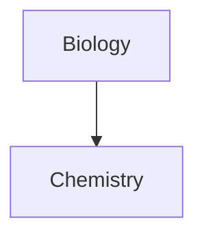
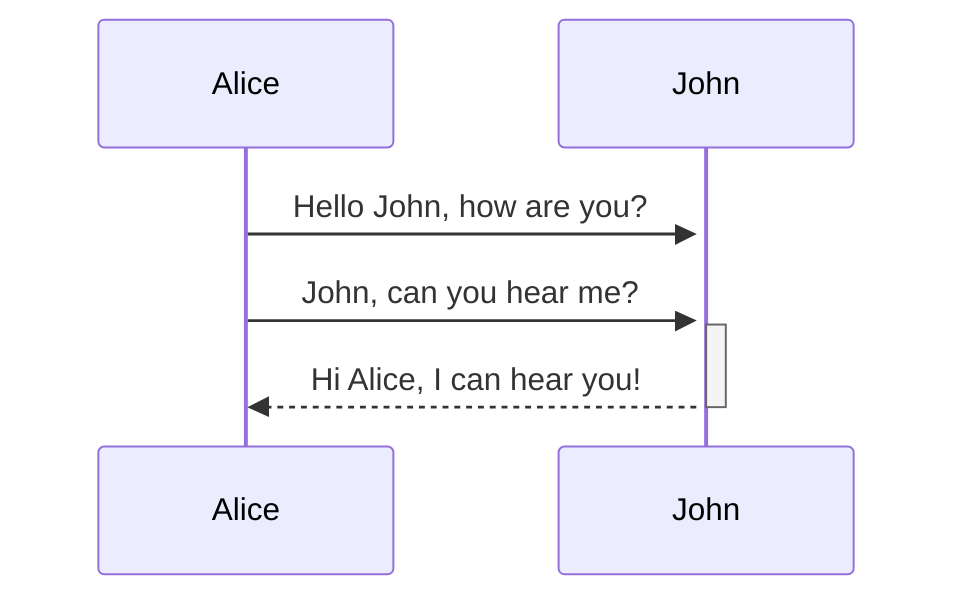

# Obsidian Flavored Markdown

Obsidian supports [CommonMark](https://commonmark.org/), [GitHub Flavored Markdown](https://github.github.com/gfm/), and [LaTeX](https://www.latex-project.org/), plus its own extensions. This note is a live showcase of everything that flavor can do.

> [!info] How to read this file
> Most sections show the **Source** in a code block and then the **Result** rendered below it. Features that are invisible when rendered (properties, comments, block IDs) are annotated in plain text. Open this file in Obsidian to see the full effects.

---

## 1. Properties (YAML front matter)

Properties are structured metadata stored in YAML at the very top of the file. They are separated from the note body by `---`.

**Source**

```yaml
---
title: Obsidian Flavored Markdown Sample
tags:
  - obsidian/sample
  - markdown
aliases:
  - Markdown Sample
cssclasses:
  - markdown-sample
author: "[[MARKDOWN_SAMPLE]]"
url: https://help.obsidian.md
created: 2026-10-17
updated: 2026-10-17T10:30:00
version: 1.0
draft: false
reviewed:
---
```

**Supported property types:** text, list, number, checkbox, date, date & time, and tags. The three default properties are `tags`, `aliases`, and `cssclasses`.

---

## 2. Paragraphs & line breaks

Separate paragraphs with a blank line. To force a line break *within* a paragraph, end the line with two trailing spaces (or use `Shift+Enter` in the editor).

**Source**

```md
This is a paragraph.

This is another paragraph.

line one  
line two
```

**Result**

This is a paragraph.

This is another paragraph.

line one  
line two

---

## 3. Headings

Up to six levels, using `#` symbols. Headings appear in the Outline and can be linked to.

**Source**

```md
# Heading 1
## Heading 2
### Heading 3
#### Heading 4
##### Heading 5
###### Heading 6
```

**Result**

# Heading 1

## Heading 2

### Heading 3

#### Heading 4

##### Heading 5

###### Heading 6

---

## 4. Text formatting

| Style | Syntax | Result |
| --- | --- | --- |
| Bold | `**bold**` or `__bold__` | **bold** |
| Italic | `*italic*` or `_italic_` | *italic* |
| Strikethrough | `~~struck~~` | ~~struck~~ |
| Highlight | `==highlighted==` | ==highlighted== |
| Bold + nested italic | `**bold and _nested italic_**` | **bold and _nested italic_** |
| Bold + italic | `***bold italic***` or `___bold italic___` | ***bold italic*** |

### Highlight colors

Add a color emoji right after the opening `==`:

```md
==🔴Red==  ==🟠Orange==  ==🟡Yellow==  ==🟢Green==  ==🔵Blue==  ==🟣Purple==
```

==🔴Red== ==🟠Orange== ==🟡Yellow== ==🟢Green== ==🔵Blue== ==🟣Purple==

Without a color emoji, the highlight uses the theme default: ==default highlight==.

---

## 5. Escaping Markdown

Prefix a special character with a backslash `\` to display it literally.

**Source**

```md
\*not italic\*  \_not italic\_  \#not a heading  \|  \~  \`
```

**Result**

\*not italic\* \_not italic\_ \#not a heading \| \~ \`

To stop a number from starting a list, escape the period: `1\. Not a list`.

---

## 6. Comments

Obsidian-specific comments use `%%`. They are only visible in Editing view, never in Reading view or published sites.

**Source**

```md
This is an %%inline%% comment.

%%
This is a block comment.
It can span multiple lines and contain Markdown.
%%
```

The line above hides the comment text in Reading view. `%%comment%% _italic_` leaves only the _italic_ part visible. To *show* `%%` as text, put it in a code span or escape it: `\%\%`.

**HTML comment** (portable to other apps): `<!-- hidden in most renderers -->`

---

## 7. Lists

### Unordered

```md
- Item
* Item
+ Item
```

- Item
- Item
- Item

### Ordered

```md
1. First
2. Second
3. Third
```

1. First
2. Second
3. Third

Numbering also works with a parenthesis: `1) First`, `2) Second`.

### Task lists

```md
- [x] Completed task
- [ ] Incomplete task
- [?] Any character marks it complete
```

- [x] Completed task
- [ ] Incomplete task
- [?] Any character marks it complete

You can toggle tasks by clicking the checkbox in Reading view.

### Nested and mixed lists

```md
1. Ordered item
   1. Nested ordered item
2. Second item
   - Nested unordered item

- [ ] Task
	- [ ] Subtask
```

1. Ordered item
   1. Nested ordered item
2. Second item
   - Nested unordered item

- [ ] Task
	- [ ] Subtask

Use `Tab` / `Shift+Tab` to indent or unindent selected items.

---

## 8. Blockquotes

Prefix text with `>`.

**Source**

```md
> Human beings face ever more complex and urgent problems.
> 
> \- Doug Engelbart, 1961
```

**Result**

> Human beings face ever more complex and urgent problems.
>
> \- Doug Engelbart, 1961

Add `[!info]` on the first line to turn a quote into a callout (see section 18).

---

## 9. Horizontal rule

Three or more `*`, `-`, or `_` on their own line, optionally spaced.

```md
***
---
___
* * *
```

***

---

## 10. Internal links

Obsidian supports two equivalent formats. Wikilinks are the default.

```md
[[Three laws of motion]]
[[Three laws of motion.md]]
[Three laws of motion](Three%20laws%20of%20motion.md)
```

- **Folder path:** `[[Projects/Three laws of motion]]` — paths start at the vault root and always use `/`.
- **Link to a heading:** `[[Note#Heading]]` — nested headings add more `#`: `[[Note#Heading#Subheading]]`.
- **Link to a heading in the same note:** `[[#Heading]]`.
- **Search headings vault-wide:** `[[## team]]`.
- **Link to a block:** `[[Note#^block-id]]` — search blocks vault-wide with `[[^^ term]]`.
- **Custom display text:** `[[Note|Display text]]`.
- **Markdown style:** `[Display text](Note.md)`.

**Defining a block ID** — put `^id` at the end of a line (for a paragraph) or on its own line (for lists, quotes, callouts, tables):

```md
The quick purple gem dashes through the paragraph. ^37066d

> A quoted block.

^37066f
```

Block IDs may contain Latin letters, numbers, and dashes, e.g. `^quote-of-the-day`.

> [!warning] Interoperability
> Block references are Obsidian-specific and will not work in other Markdown apps.

---

## 11. External links & images

```md
[Obsidian Help](https://help.obsidian.md)

```

**Result**

[Obsidian Help](https://help.obsidian.md)

Escape spaces in URLs with `%20` or wrap the URL in angle brackets:

```md
[Note](obsidian://open?vault=MainVault&file=Note.md)
[My Note](<obsidian://open?vault=MainVault&file=My Note.md>)
```

### Image sizing

Append `|widthxheight` to the destination. One value scales proportionally.

```md


```


---

## 12. Embeds

Prefix a link with `!` to embed its content inline. The embed updates when the source file changes.

```md
![[Note]]                      embed a note
![[Note#Heading]]              embed a heading section
![[Note#^block-id]]            embed a block
![[Image.png]]                 embed an image
![[Image.png|100x145]]         embed an image at a size (one value = proportional)
![[Audio.ogg]]                 embed audio
![[Document.pdf]]              embed a PDF
![[Document.pdf#page=3]]       embed a specific PDF page
![[Document.pdf#height=400]]   set viewer height (combine with &)
![[My canvas.canvas]]          embed a canvas
![[Note#^my-list-id]]          embed a list via its block ID
   embed an external image at a width
```

Markdown-style embeds also accept sizing: ``.

To reference content that isn't a file (like a saved search), you can embed a block from another note, e.g. `![[Search#Embed search results in a note]]`.

---

## 13. Footnotes

**Source**

```md
A simple footnote[^1].

An inline footnote.^[This is an inline footnote.]

[^1]: This is the referenced text.
[^2]: Footnotes can span
  multiple lines by indenting continuation lines.
[^note]: Named footnotes still render as numbers.
```

**Result**

A simple footnote[^1].

An inline footnote.^[This is an inline footnote — it only renders in Reading view, not Live Preview.]

[^1]: This is the referenced text.
[^2]: Footnotes can span multiple lines by indenting continuation lines.
[^note]: Named footnotes still render as numbers.

---

## 14. Tables

Separate columns with `|` and define the header with `-`. Outer pipes are optional but recommended.

**Source**

```md
| First name | Last name |
| ---------- | --------- |
| Max        | Planck    |
| Marie      | Curie     |
```

**Result**

| First name | Last name |
| ---------- | --------- |
| Max        | Planck    |
| Marie      | Curie     |

The header row must contain at least two hyphens. Cells need not align perfectly.

### Alignment

```md
Left | Center | Right
:--- | :---: | ---:
Content | Content | Content
```

Left | Center | Right
:--- | :---: | ---:
Content | Content | Content

### Formatting inside tables

Basic formatting, links, and embeds work inside cells. Escape the pipe when using an alias or image size inside a cell:

```md
| Column A | Column B |
| --- | --- |
| [[Note\|Alias]] | ![[Image.png\|100]] |
```

---

## 15. Code

### Inline code

```md
Text with `inline code` in it.
```

Text with `inline code` in it. To include a backtick, wrap with double backticks: ``code with a ` inside``.

### Code blocks

Fence with three or more backticks or tildes, or indent with four spaces.

````md
```
plain code block
```

```js
function fancyAlert(arg) {
  if (arg) {
    console.log("Syntax highlighting via Prism.js");
  }
}
```
````

Syntax highlighting uses [Prism](https://prismjs.com/#supported-languages); add the language name after the opening fence. Note: Source mode and Live Preview do not render Prism highlighting.

### Nesting code blocks

Use a longer fence (or different fence character) for the outer block:

`````md
````md
Here's how to create a code block:
```js
console.log("Hello world")
```
````
`````

---

## 16. Math

Obsidian renders LaTeX via MathJax.

**Inline**

```md
This is inline math: $e^{2i\pi} = 1$.
```

This is inline math: $e^{2i\pi} = 1$.

**Block**

```md
$$
\begin{vmatrix}a & b\\
c & d
\end{vmatrix}=ad-bc
$$
```

$$
\begin{vmatrix}a & b\\
c & d
\end{vmatrix}=ad-bc
$$

---

## 17. Diagrams (Mermaid)

Create a fenced code block with the `mermaid` language.

### Flowchart

````md

````


### Sequence diagram

````md

````


### Internal links in diagrams

Attach the `internal-link` class to nodes to make them clickable links.

````md

````


---

## 18. Callouts

Add `[!type]` as the first line of a blockquote. The type sets the icon and color; an unsupported type falls back to `note`. Types are case-insensitive.

**Source**

```md
> [!info] A custom title
> Callouts support **Markdown**, [[Internal links|wikilinks]], and embeds.
> ![[Image.png]]

> [!tip]- Foldable (collapsed by default)
> Add `+` to expand by default, `-` to collapse.

> [!question] Nesting
> > [!todo] Yes, callouts nest.
> > > [!example] Multiple levels deep.
```

**Result**

> [!info] A custom title
> Callouts support **Markdown**, wikilinks, and embeds.

> [!tip]- Foldable (collapsed by default)
> Add `+` to expand by default, `-` to collapse.

> [!question] Nesting
> > [!todo] Yes, callouts nest.
> > > [!example] Multiple levels deep.

You can omit the body for a title-only callout: `> [!tip] Title only`.

### Supported callout types

| Type | Aliases |
| --- | --- |
| `note` | — |
| `abstract` | `summary`, `tldr` |
| `info` | — |
| `todo` | — |
| `tip` | `hint`, `important` |
| `success` | `check`, `done` |
| `question` | `help`, `faq` |
| `warning` | `caution`, `attention` |
| `failure` | `fail`, `missing` |
| `danger` | `error` |
| `bug` | — |
| `example` | — |
| `quote` | `cite` |

> [!note]
> > [!abstract]
> > Lorem ipsum dolor sit amet

> [!tip]
> > [!todo]
> > Lorem ipsum dolor sit amet

> [!warning]
> > [!danger]
> > Lorem ipsum dolor sit amet

### Custom callouts

CSS snippets (or community plugins) can define new callout types:

```css
.callout[data-callout="custom-question-type"] {
    --callout-color: #000000;
    --callout-icon: lucide-alert-circle;
}
```

Then use it with `> [!custom-question-type]`.

---

## 19. Tags

Create a tag with `#` followed by a keyword. Tags cannot contain spaces; use `#camelCase`, `#PascalCase`, `#snake_case`, or `#kebab-case`.

```md
#meeting #inbox/to-read #y1984
```

#meeting #inbox/to-read #y1984

- Nested tags use `/` and form hierarchies (`tag:inbox` matches `#inbox/to-read`).
- Tags must contain at least one non-numeric character (`#1984` is invalid).
- Tags are case-insensitive and are often defined in the `tags` property instead.

---

## 20. HTML content

Obsidian sanitizes HTML for safety, but supports many tags. Note that Markdown is **not** parsed inside HTML elements, and HTML blocks cannot contain blank lines.

```html
<u>Underlined text</u>
<s>Struck-out text</s>
<span style="font-family: cursive">custom-styled text</span>
<!-- an HTML comment -->
```

**Result**

<u>Underlined text</u> · <s>Struck-out text</s> · <span style="font-family: cursive">custom-styled text</span>

Use `<span>`/`<div>` with `style` or a CSS class from a snippet to style regions.

---

## 21. Embedding web pages

Use the `iframe` element, or Markdown image syntax for supported sites.

```html
<iframe src="https://www.youtube.com/embed/NnTvZWp5Q7o"></iframe>
```

```md


```

Some sites block embedding; look for an "embed" URL (e.g. "youtube embed iframe").

---

## 22. Slides

Any note can be a presentation. Separate slides with `---` on its own line, then start the presentation with the **Start presentation** command.

```md
# Slide one

---

## Slide two

Content here.
```

---

## 23. Escaping oddities & notes

- **Numbers:** `1\. Item` prevents list formatting.
- **Pipes in tables:** escape as `\|`.
- **Newlines in HTML:** must be self-contained with no blank lines.
- **Reserved link characters:** avoid `# | ^ : %% [[ ]]` in file names.
- **Comments & highlights & wikilinks & block references** are Obsidian-specific; other apps will show them as plain text.
- **Bases** (`.base` files), **Canvas** (`.canvas`), and **Excalidraw** are separate file formats, not Markdown syntax.
- Community plugins (e.g. Dataview) add query blocks such as ```` ```dataview ```` on top of this base syntax.

---

### Quick reference

| Feature | Syntax |
| --- | --- |
| Wikilink | `[[Note]]` |
| Embed | `![[File]]` |
| Block reference | `[[Note#^id]]` / `^id` |
| Heading link | `[[Note#Heading]]` |
| Alias in link | `[[Note\|Text]]` |
| Footnote | `[^1]` |
| Comment | `%%…%%` |
| Highlight | `==text==` |
| Strikethrough | `~~text~~` |
| Task | `- [ ]` / `- [x]` |
| Callout | `> [!note]` |
| Table | `\| a \| b \|` |
| Math | `$…$` / `$$…$$` |
| Diagram | ```` ```mermaid ```` |
| Tag | `#tag` |
| Property | YAML front matter |
